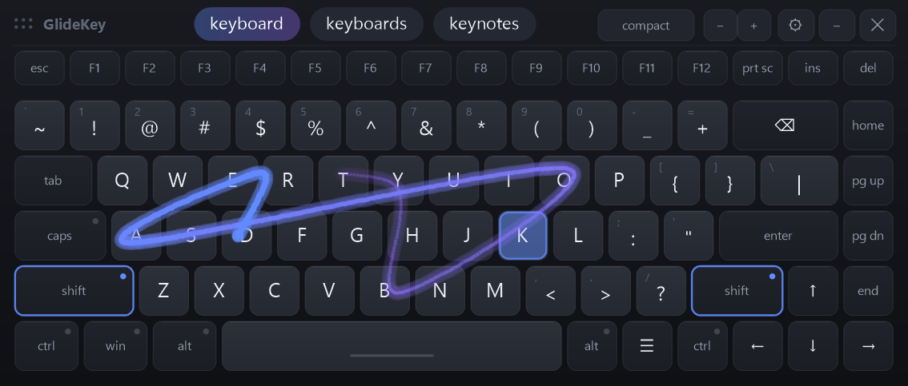
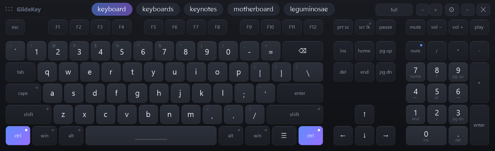

# GlideKey

A Windows on-screen keyboard with phone-style swipe (glide) typing, and every key a physical keyboard has. It never steals focus from the app you're typing in.





## Install

Download from [Releases](../../releases):

- **`GlideKey-win-x64.zip`** (~1 MB): needs the [.NET 9 Desktop Runtime](https://dotnet.microsoft.com/download/dotnet/9.0).
- **`GlideKey-win-x64-selfcontained.zip`** (larger): runs with nothing installed.

Unzip and run `GlideKey.exe`. A tray icon appears: left-click it to show or hide the keyboard, and right-click it (or use ⚙ on the keyboard) for options. There's no installer; delete the exe to uninstall. Settings are stored in `%APPDATA%\GlideKey`.

## Using it

| Thing | How |
|---|---|
| Type a key | Click it. The window never takes focus, so keys go to the app you were typing in. |
| Swipe a word | Press a letter and glide through the word's letters, then release. The word is typed with a trailing space. Live guesses show in the top bar while you swipe. |
| Pick another guess | After a swipe, tap a word in the top bar to replace the one just typed. |
| Shift / Ctrl / Alt / Win | Tap once = applies to the next key (outlined). Tap twice or long-press = locked (filled) until tapped again. Win tapped twice opens Start. |
| Held keys | Backspace, arrows, letters etc. auto-repeat when held, like a real keyboard. |
| Caps / Num / Scroll Lock | Real OS toggles. The indicators follow the physical keyboard too. |
| Phone conveniences | Double-tap space = ". "; `.`, `,`, `?`, `!`… after a swiped word moves the space after the punctuation; Backspace right after a swipe deletes the whole word; sentence starts are capitalised. Each can be turned off in the menu. |
| Layouts | **compact** (65%: F-row, arrows, nav keys) or **full** (104 keys + numpad + media keys). Toggle in the header. |
| Minimize / hide | `–` minimizes to the taskbar (click the taskbar button to restore); `✕` hides to the tray. Clicking a pinned taskbar shortcut brings it back from either state instead of starting a second copy. GlideKey never moves focus itself, so after it reappears, click back into your text box. |
| Size / move | `−` `+` in the header, or Size in the menu. Drag the header to move. Position, size and options persist in `%APPDATA%\GlideKey\settings.json`. |

Limitation: Windows blocks input from normal apps into elevated (admin) windows. To type into those, run GlideKey as administrator.

## Build & test

```powershell
cd cs
dotnet build -c Release
bin\Release\net9.0-windows\GlideKey.exe --unittest   # layouts, VK codes, modifier/typing logic, swipe accuracy benchmark
bin\Release\net9.0-windows\GlideKey.exe --smoke      # real window driven by WM_LBUTTON*/WM_MOUSEMOVE, injection logged not sent
bin\Release\net9.0-windows\GlideKey.exe --render out compact   # out_idle/_swipe/_after.png
dotnet publish -c Release -r win-x64 --self-contained false -p:PublishSingleFile=true -o ..\release
..\tools\package.ps1   # builds both release zips into dist\
..\tools\make_icon.ps1  # regenerates assets\glidekey.ico (add -PreviewPng to eyeball every size)
```

The test modes are GUI-subsystem exes, so capture output with
`Start-Process GlideKey.exe --unittest -Wait -NoNewWindow -RedirectStandardOutput out.txt`.
Set `GK_DEBUG=1` to log pointer events, swipe results and injections to `%LOCALAPPDATA%\GlideKey\debug.log`.

## Code map (`cs\src`)

- `KeyModel.cs`: VK table, key definitions, both layouts (every row sums to the same width, so columns line up), geometry.
- `Controller.cs`: what a press means: taps, typematic repeat, swipe start/commit, suggestions, smart spacing. It has no UI dependency, so tests drive it directly.
- `ModifierState.cs`: sticky / locked / chorded modifiers.
- `SwipeEngine.cs`: dictionary + recogniser. Elastic alignment of the trace to each candidate word's key path (letters mandatory, direction-aware transit runs), with a frequency prior. Pruned by start/end letters, letter reach, and a cheap lower bound. A 1.7–5 ms average in Release.
- `InputInjector.cs`: `SendInput` batches (layout-aware chars via `VkKeyScanEx`, Unicode fallback), with a `keybd_event` fallback and a SelfTest log mode.
- `KeyboardForm.cs`: no-activate topmost window (`WS_EX_NOACTIVATE` + `MA_NOACTIVATE`), GDI+ renderer with a cached key layer, DPI-aware.
- `Program.cs`: entry, settings, tray, single instance (a second launch broadcasts a registered message so the running copy unhides instead of starting a second keyboard). `Tests.cs`: unit, smoke and render modes.

## Dictionary

`cs\assets\words.txt` (embedded) is 90k entries ordered by real frequency, including contractions (`dont` → "don't"). It is built by `tools\build_dict.ps1` from two inputs (not in the repo; download them into `tools\`):

- `count_1w.txt`: word frequencies from Peter Norvig's [ngrams data](https://norvig.com/ngrams/) (derived from the Google Web Trillion Word Corpus).
- `spell_words.txt`: a spelling filter, e.g. [dwyl/english-words](https://github.com/dwyl/english-words) `words_alpha.txt` (Unlicense), which removes web junk from the frequency list.

## License

MIT (see [LICENSE](LICENSE)).
